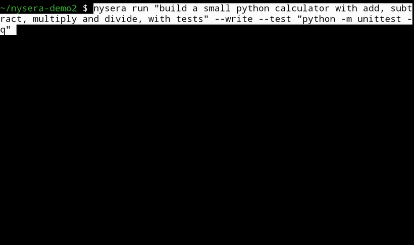
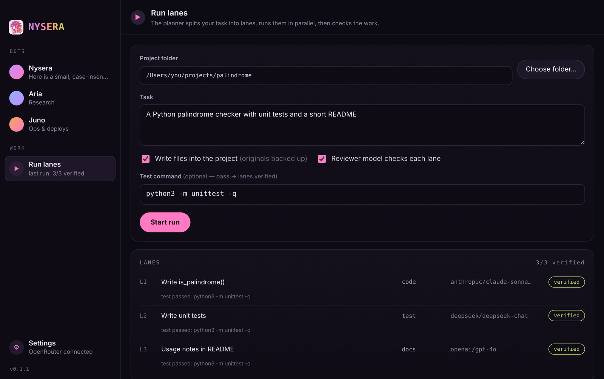

<div align="center">


# Nysera

**An AI agent crew in your terminal.**
Give it a task — it plans the work as parallel lanes, runs each lane on the right model,
and only calls work **verified** when a real check passed.

[](LICENSE)
[](https://nodejs.org)
[](https://openrouter.ai)
[](https://github.com/nysera-dev/nysera-desktop/releases/latest)

[Website](https://nysera.app) · [Install](#install) · [How it works](#how-it-works) · [Desktop app](https://github.com/nysera-dev/nysera-desktop)



<sub>A real, unedited run recorded on a phone (Termux): live models through OpenRouter, real files, real <code>python -m unittest</code>. Idle seconds trimmed.</sub>

</div>

---

## Why Nysera

- **Parallel lanes.** A planner model splits your task into 2–7 lanes with dependencies. Lanes that don't depend on each other run at the same time.
- **The right model per lane.** Every lane gets a category — `code`, `test`, `docs`, `deep`, `quick`, `research` — and each category has its own ordered model chain.
- **No silent downgrade.** If a model fails, the next one in the chain takes over, and the log says which model actually answered.
- **Evidence before "done".** A lane is only `verified` when your test command passes, or a separate reviewer model passes it. A failed test keeps it `reported`.
- **One key, many providers.** Everything goes through [OpenRouter](https://openrouter.ai), so one API key covers OpenAI, Claude, Gemini, DeepSeek, Qwen, Kimi, Mistral and more.
- **Safe by default.** Nothing in your project changes unless you pass `--write`, and even then originals are backed up first.

## Install

Requires [Node.js](https://nodejs.org) 18+ and Git.

```bash
npm i -g github:nysera-dev/nysera
```

Or from a clone:

```bash
git clone https://github.com/nysera-dev/nysera && cd nysera && npm link
```

## Quick start

```bash
nysera setup     # paste your OpenRouter key (openrouter.ai/keys)
nysera doctor    # checks Node, your key, and that every model in your chains exists
nysera run "add a /health endpoint to the express app and test it" --write --test "npm test"
```

Every run uses live models on your own OpenRouter key: real files, real tests, no canned output.

## How it works

```
plan  →  lanes in parallel (layer by layer)  →  collect files  →  verify  →  report
```

| Status | Meaning |
|---|---|
| `planned` | In the plan. Nothing has run yet. |
| `running` | A model from the lane's chain is working on it. |
| `reported` | The model says it finished. Nobody has checked it. |
| `verified` | Your `--test` command passed, or the reviewer model passed it. |
| `failed` / `skipped` | Every model in the chain failed, or a lane it depends on did. |

Every run is saved in `.nysera/runs/<id>/`: `summary.md`, each lane's full output, generated files, and test output.

## Commands

| Command | What it does |
|---|---|
| `nysera setup` | Save and check your OpenRouter key, write default model chains. |
| `nysera doctor` | Check Node, the key, and that every model ID still exists. |
| `nysera run "<task>"` | Plan → parallel lanes → verify. |
| `nysera model` | Show the chain per category. |
| `nysera model set <cat> <id,id,…>` | Change a category's chain. |
| `nysera model effort <cat> <low\|medium\|high>` | Change how much a category's model may write. |
| `nysera model reset` | Back to the default chains. |
| `nysera runs` | List past runs in this folder. |

### `nysera run` options

| Option | What it does |
|---|---|
| `--write` | Write generated files into the project. Existing files are backed up into the run folder first. |
| `--test "<cmd>"` | Run a command after the lanes. Pass → lanes are `verified`. |
| `--no-review` | Skip the reviewer model. |
| `--concurrency <n>` | Max lanes at once (default 4). |
| `--dir <path>` | Project folder (default: current folder). |
| `--fix <n>` | When `--test` fails, a fixer model reads the failure, repairs the files and re-runs the check, up to `n` times (default 2, `0` = off). |
| `--no-tui` | Plain log lines instead of the live board. |

## Model chains

| Category | Default chain | Effort |
|---|---|---|
| `plan` | claude-sonnet-latest → gpt-latest → gemini-pro-latest → deepseek-chat | high |
| `code` | claude-sonnet-latest → deepseek-chat → gpt-latest | medium |
| `test` | claude-sonnet-latest → deepseek-chat → gpt-latest | medium |
| `docs` | gpt-mini-latest → gemini-flash-latest → deepseek-chat | low |
| `deep` | claude-sonnet-latest → gemini-pro-latest → gpt-latest | high |
| `quick` | gemini-flash-latest → deepseek-chat → gpt-mini-latest | low |
| `research` | gemini-pro-latest → claude-sonnet-latest → kimi-latest | high |
| `review` | gpt-latest → gemini-pro-latest → claude-sonnet-latest | high |

IDs starting with `~` are OpenRouter "latest" aliases — they always point to the newest model in that family, so they never go stale. Chains live in `~/.nysera/routing/model-chains.json`; run `nysera doctor` after editing.

## Prefer a window?

[**Nysera Desktop**](https://github.com/nysera-dev/nysera-desktop/releases/latest) for macOS (Apple silicon) and Windows runs the same engine, with chat bots and a live lanes view.



## Safety

- Files are only written inside the project folder; absolute paths and `..` are refused.
- Without `--write`, Nysera never touches your project files.
- `--test` runs the command you give it in your shell — only pass commands you trust.
- Your key is stored in `~/.nysera/config.json` with owner-only permissions, or read from `OPENROUTER_API_KEY`.

## Contributing

Bug reports and ideas are welcome — see [CONTRIBUTING.md](CONTRIBUTING.md) and open an [issue](https://github.com/nysera-dev/nysera/issues/new/choose).

## License

[MIT](LICENSE)
